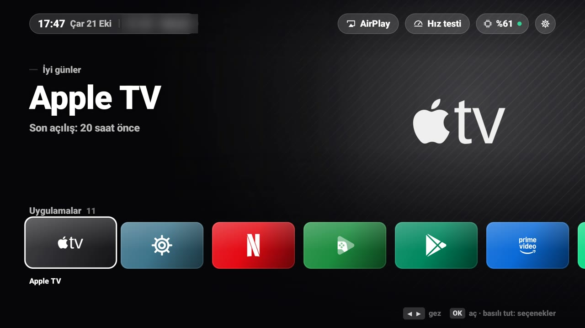
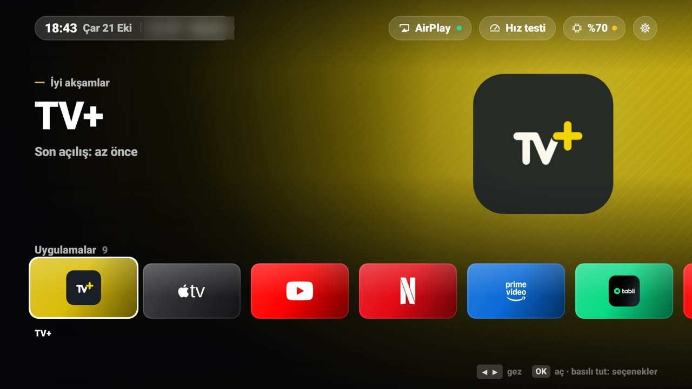
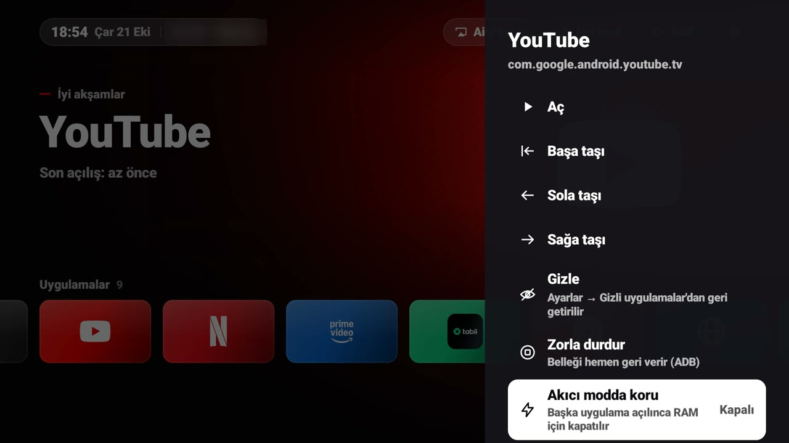
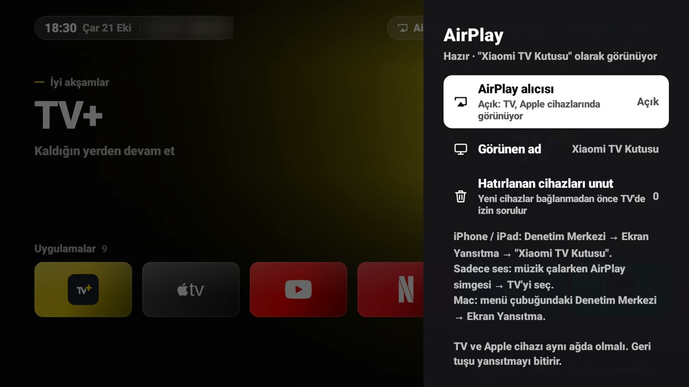
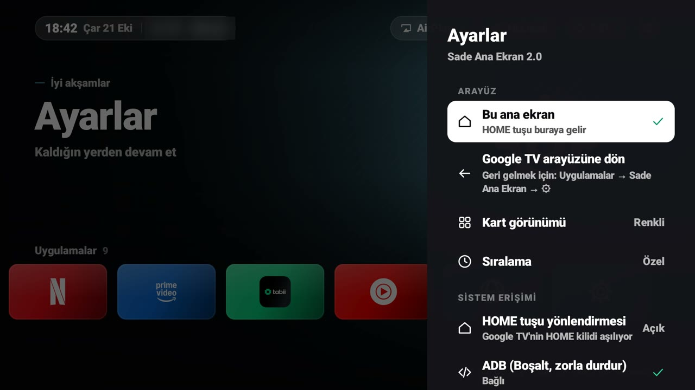

<div align="center">

# Sade Ana Ekran

**Xiaomi Mi Box S için hafif, sinematik ve Apple TV hissi veren bir ana ekran.**
Google TV'nin ağır arayüzünün yerine geçer; istediğin an tek tıkla eski arayüze dönersin.

[English](README.md) | **Türkçe**




</div>

---

## Öne çıkanlar

- **Sinematik ana ekran:** Seçili uygulamanın renginde tam ekran arka plan ve büyük, keskin logo. Kartlar yaylanarak büyür, üzerlerinden ışık geçer.
- **Sade simgeler:** Marka simgeleri ([Simple Icons](https://simpleicons.org), CC0) ve resmi marka renkleri. Simgesi olmayan uygulamalar için logodan beyaz silüet üretilir.
- **Yerleşik AirPlay:** iPhone, iPad ve Mac'ten ekran yansıtma ve ses. Ek uygulama gerekmez. Yeni bir cihaz bağlanmadan önce TV'de **izin sorulur**.
- **Akıcı mod:** Açtığın uygulamaya RAM'i bırakır, arka plandakileri kapatır. Korumak istediğin uygulamaları seçebilirsin.
- **Üst çubuk:** Saat, tarih, hava durumu, RAM göstergesi, AirPlay durumu ve hız testi.
- **Tarayıcı:** Google TV'de olmayan bir internet tarayıcısı; kumandanın yön tuşları fare imleci olur.
- **Hafif:** androidx, Compose ya da üçüncü parti kütüphane yok. Ana ekranın kendisi ~50-60 MB RAM kullanır; Google TV ana ekranı ~140 MB kullanıyor.

## Ekran görüntüleri

| | |
|:-:|:-:|
|  |  |
| Ana ekran | Uzun basma menüsü |
|  |  |
| AirPlay | Ayarlar |

---

## Kurulum

**Gerekenler:** JDK 17+, Android SDK (platform 35), `adb`. Kutu ve bilgisayar aynı ağda olmalı.

1. **Kutuda geliştirici modunu aç:** Ayarlar → Sistem → Hakkında → *Android TV OS derlemesi*'ne 7 kez bas. Sonra Geliştirici seçenekleri → **USB hata ayıklama: Açık**.
2. **Derle ve yükle:**
   ```bash
   ./gradlew assembleRelease
   adb connect <KUTU_IP>:5555
   adb install -r app/build/outputs/apk/release/app-release.apk
   ```
3. **İlk açılış:** Google TV → Uygulamalar → **Sade Ana Ekran** → ⚙ → **ADB → Bağlan**. TV'de çıkan pencerede *"Her zaman izin ver"*i işaretleyip onayla.

Bu kadar. Uygulama HOME yönlendirmesini ve gerekli izinleri kendisi ayarlar.

> `local.properties` dosyasında `sdk.dir=/Android/sdk/yolu` olmalı. Android Studio bu dosyayı kendisi oluşturur.

## Kullanım

| Kumanda | Ne olur |
|---|---|
| ◀ ▶ | Uygulamalar arasında gez |
| ▲ ▼ | Üst çubuk ↔ uygulamalar |
| OK | Aç |
| OK'e basılı tut / Menü | Taşı, gizle, zorla durdur, Akıcı modda koru, kaldır |
| Geri | Paneli kapatır |
| HOME | Her yerden bu ana ekrana döner |

**Eski arayüze dönmek:** ⚙ → *Google TV arayüzüne dön*. Tekrar gelmek için Google TV → Uygulamalar → Sade Ana Ekran → ⚙ → *Bu ana ekranı kullan*.

## AirPlay

- **Ekran yansıtma:** iPhone/iPad'de Denetim Merkezi → **Ekran Yansıtma** → *"(TV'nin adı) AirPlay"*. Mac'te ise menü çubuğu → Denetim Merkezi → Ekran Yansıtma.
- **Sadece ses:** Müzik çalarken AirPlay simgesi → TV.
- **İzin:** Yeni bir cihaz bağlanınca TV'de **Reddet / Bu sefer izin ver / Her zaman izin ver** sorulur. 30 saniye içinde cevap verilmezse istek reddedilir. Hatırlanan cihazları ⚙ → AirPlay'den silebilirsin.
- **Bitirmek:** iPhone'da *Yansıtmayı Durdur* ya da TV'de **Geri** tuşu.

## Akıcılık

**Akıcı mod** (⚙ → Akıcılık, varsayılan olarak açık): Bir uygulamayı açtıktan ~4 saniye sonra arka planda kalanları kapatır. Kapatılmasını istemediğin uygulamaya uzun basıp **Akıcı modda koru**'yu seç; Play Store varsayılan olarak korunur.

Mi Box S üzerinde ölçülen değerler:

| | Sonuç |
|---|---|
| Ana ekranda gezinme | kare düşmesi **~%1** |
| Netflix (arka planda 3 uygulama açıkken) | kaçırılan kare **%52 → %5** (Akıcı mod ile) |

İpucu: Ayarlar → Ekran ve Ses → Gelişmiş görüntü → **İçerik kare hızını eşleştir** açıkken filmler (24 kare/sn) sarsıntısız oynar.

<details>
<summary><b>TV'yi hızlandır</b>: gereksiz ön yüklü uygulamaları kapat</summary>

⚙ → Akıcılık → **TV'yi hızlandır**. Uygulamalar **silinmez**; `pm disable-user` ile kapatılır ve tek tıkla (ya da *Hepsini geri aç* ile) geri açılır.

| Önerilen | Kullanmıyorsan |
|---|---|
| Xiaomi Galeri, Xiaomi Media Player | YouTube Kids, YouTube Music |
| Google Geri Bildirim, Play Oyunlar | Miracast |
| Yazdırma hizmeti, eski ekran koruyucular | Ambient mod |
| TalkBack | Google TV öneri şeritleri |

**Asla dokunulmayanlar:** yayın uygulamaları, Play Store, Google Play Hizmetleri, sesli arama, Chromecast, klavye, kumanda servisi ve Google TV ana ekranı.
</details>

<details>
<summary><b>Sorun giderme</b></summary>

| Sorun | Çözüm |
|---|---|
| HOME tuşu Google TV'ye gidiyor | ⚙ → *HOME tuşu yönlendirmesi*. Uygulama "Zorla durdur" yapılırsa Android bu servisi kapatır. Güncellemeden hemen sonra basılan ilk HOME da kaçabilir. |
| iPhone'da TV görünmüyor | TV ile telefon aynı Wi‑Fi'da mı? ⚙ → AirPlay açık mı (çipteki nokta yeşil olmalı)? Misafir ağlarında ya da "istemci yalıtımı" açık modemlerde görünmez. |
| Akıcı mod çalışmıyor | ⚙ → ADB → *Bağlı* olmalı. Kutu yeniden başlayınca ADB portu kapanabilir: `adb connect <KUTU_IP>:5555` ve ardından `adb tcpip 5555`. |
| Hava durumu yok | İnternet yoksa gizlenir. ⚙ → Hava durumu → şehri elle seç. |
| Yansıtmada görüntü gelmiyor | `adb logcat -s SadeAirPlay` çıktısına bak. |

**Tamamen kaldırmak:** `adb uninstall com.hizir.sadehome`. HOME yönlendirmesi ve izinler kendiliğinden sıfırlanır. "TV'yi hızlandır" ile kapattıkların ise kapalı kalır; kaldırmadan önce *Hepsini geri aç*'a bas.
</details>

<details>
<summary><b>Proje yapısı</b></summary>

```
app/src/main/java/com/hizir/sadehome/
├── LauncherActivity.kt      Ana ekran: düzen, odak, paneller
├── HomeActivity.kt          HOME'un görünmez yönlendiricisi (yeni / Google TV)
├── HomeWatcherService.kt    Erişilebilirlik servisi: Google TV'nin HOME kilidini aşar
├── adb/                     Bağımlılıksız ADB istemcisi (kendi kutusuna bağlanır)
├── airplay/                 Yerleşik AirPlay alıcısı: RTSP, eşleştirme, FairPlay, H.264, AAC/ALAC, izin penceresi
├── browser/                 Tarayıcı (WebView + kumanda imleci)
├── data/                    Uygulama listesi, sade simgeler (Marks), ayarlar, hava durumu, hız testi
├── system/                  Akıcı mod, TV'yi hızlandır, HOME kontrolü
└── ui/                      Kart, kaydırmalı satır, arka plan, yan panel, çizilmiş ikonlar
```

Kotlin 2.0.21 · AGP 8.7.3 · Gradle 8.11.1 · minSdk 26 · targetSdk 34.
</details>

---

## Lisans ve teşekkür

- `airplay/FairPlay.kt`, [UxPlay](https://github.com/FDH2/UxPlay)'deki *playfair* kodunun Kotlin portudur ve **GPL-3.0** lisanslıdır. AirPlay protokol akışı da UxPlay referans alınarak yazıldı. Bu yüzden uygulama dağıtılacaksa kaynak kodu GPL-3.0 ile paylaşılmalıdır.
- Marka simgeleri [Simple Icons](https://simpleicons.org)'tan (CC0) alındı; logolar sahiplerine aittir.
- Kişisel kullanım için geliştirildi. Google, Xiaomi ya da Apple ile bir bağı yoktur.

<div align="center"><sub>Geliştiren: <b>Yavuzhan Kurşun</b></sub></div>
